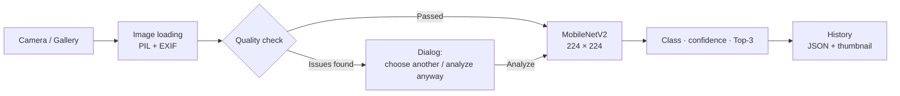

# 🌿 Plant Doctor

**English** | [Русский](README.ru.md)

A plant disease detection app that identifies the plant, the most likely disease, and the model's confidence from a photo of a leaf. Users can take a picture with the camera or pick an existing image.

Built with **Python**, **Flet**, and **PyTorch**, and runs as a web app in the browser.


## 🎓 Project Information

| | |
|---|---|
| **University** | Brest State Technical University |
| **Department** | IIT |
| **Discipline** | Applied Intelligent Systems |
| **Group** | AI-26 (ИИ-26) |
| **Students** | D. A. Rubtsov, M. A. Pilipuk |

---

## Features

- 📷 **Camera and gallery** — capture a leaf directly in the app or pick a photo from the gallery.
- 🖼️ **Preview** — the selected photo is shown on screen and can be replaced with another one.
- 🧠 **Classification** — the model recognizes 39 classes: 26 diseases, 12 healthy states, and a no-leaf background; 14 crops are supported in total.
- 📊 **Top-3 predictions** — the result shows the class, confidence, and the three most likely options.
- 🩺 **Input photo checks** — the app warns when an image is too dark, overexposed, blurry, or too small.
- 🕘 **Analysis history** — the last 50 results are stored with the photo, date, class, confidence, and source.
- 🌱 **Help screen** — a list of supported plants and photo tips.
- 🧯 **Error handling** — corrupted files, an unavailable camera, and other issues are reported with clear messages.

---

## How It Works



1. The image is loaded with Pillow, EXIF orientation is applied, and it is converted to RGB.
2. A fast heuristic quality check runs.
3. The photo is resized to 224×224 and normalized the same way as during training.
4. MobileNetV2 outputs probabilities for 39 classes.
5. The result is displayed in a card and saved to history.

---

## Supported Plants

Apple, Blueberry, Cherry, Corn, Grape, Orange, Peach, Pepper (bell), Potato, Raspberry, Soybean, Squash, Strawberry, Tomato.

The model can also recognize healthy leaves and the `Background_without_leaves` class — a photo without a leaf. Class names are stored in the checkpoint, so predictions and the UI always stay in sync.

---

## Quick Start

### Requirements

- Python **3.10+**
- pip
- About 2–3 GB of free space for PyTorch and dependencies

### Installation

```bash
git clone https://github.com/RebellionHQ/PlantDiseasesDetection.git
cd PlantDiseasesDetection

python -m venv .venv
source .venv/bin/activate        # Windows: .venv\Scripts\activate

pip install -r gui/requirements.txt
```

### Run

From the repository root:

```bash
python gui/main.py
```

The app opens in your browser at **http://127.0.0.1:8550**.

> **Camera in the browser** only works on `localhost` or over HTTPS — this is a browser restriction. If the camera is unavailable, use the **Gallery** button: the analysis result is the same.

---

## Usage

1. Click **Camera** to take a photo or **Gallery** to choose a file.
2. If the photo is too dark, too bright, blurry, or too small, a dialog explains the issue. You can choose another photo or click **Analyze anyway**.
3. Wait for the result: the app shows the plant, disease, confidence, and Top-3 predictions.
4. Every successful analysis is saved to the **History** tab, which keeps the last 50 entries.
5. The **Plants** tab lists supported plants and photo tips.

History is stored locally:

- by default at `~/.plant_doctor/history.json`;
- the path can be overridden with the `PLANT_APP_DATA` environment variable.

---

## Project Structure

```text
.
├── gui/
│   ├── main.py           # Flet UI and user flows
│   ├── classifier.py     # image loading and model wrapper
│   ├── image_quality.py  # resolution, brightness, and sharpness checks
│   ├── history.py        # local analysis history
│   └── requirements.txt  # app dependencies
│
├── model/
│   ├── model.py          # MobileNetV2 architecture and weight loading
│   ├── model_api.py      # inference: class, confidence, Top-3
│   ├── dataset.py        # dataset loading and augmentations
│   ├── train.py          # training and fine-tuning
│   └── weights/
│       └── model.pth     # trained weights
│
├── README.md             # English documentation
└── README.ru.md          # Russian documentation
```

---

## Model

| Parameter | Value |
|---|---|
| Architecture | MobileNetV2 (ImageNet pretrained) |
| Classes | 39 |
| Input | 224 × 224, ImageNet normalization |
| Batch size | 32 |
| Optimizer | Adam, 1e-3 → 1e-5 during fine-tuning |
| Epochs | 5 + 3 fine-tuning |
| Device | CPU |
| Weights | `model/weights/model.pth` |

The checkpoint contains `model_state_dict` and `class_names`, so the class list does not have to be maintained separately.

### Training

The dataset is not included in the repository. Training requires a local `data/` folder in the project root with an `ImageFolder` layout:

```text
data/
├── Apple___Apple_scab/
│   ├── image_001.jpg
│   └── ...
├── Apple___healthy/
├── Tomato___Late_blight/
└── ...
```

Folder names must match the classes of a PlantVillage-like dataset. Run training from the repository root:

```bash
pip install tqdm
python model/train.py
```

The script trains the classifier, performs fine-tuning, and saves the best weights to `model/weights/model.pth`.

---

## Technologies

- [Flet](https://flet.dev/) — cross-platform UI in Python
- [PyTorch](https://pytorch.org/) and [torchvision](https://pytorch.org/vision/) — training and inference
- [Pillow](https://python-pillow.org/) — image processing
- [NumPy](https://numpy.org/) — brightness and sharpness analysis
- [flet-camera](https://pypi.org/project/flet-camera/) — camera access

---

<p align="center">
  Brest State Technical University · Department of Intelligent Information Technologies<br>
  Group AI-26 (ИИ-26) · D. A. Rubtsov and M. A. Pilipuk · 2026
</p>
