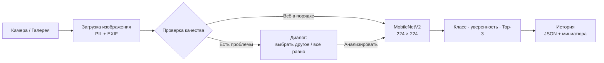

# 🌿 Plant Doctor

[English](README.md) | **Русский**

Приложение для распознавания болезней растений по фотографии листа. Пользователь делает снимок через камеру или выбирает готовое изображение, а модель определяет растение, наиболее вероятное заболевание и уверенность предсказания.

Проект собран на **Python**, **Flet** и **PyTorch** и запускается как веб-приложение в браузере.


## 🎓 О проекте

| | |
|---|---|
| **Университет** | Брестский государственный технический университет |
| **Кафедра** | ИИТ |
| **Дисциплина** | Прикладные интеллектуальные системы |
| **Группа** | ИИ-26 |
| **Студенты** | Рубцов Д. А., Пилипук М. А. |

---

## Возможности

- 📷 **Камера и галерея** — съёмка листа прямо в приложении или выбор фотографии из галереи.
- 🖼️ **Предпросмотр** — выбранное фото отображается на экране, его можно заменить другим.
- 🧠 **Классификация** — модель распознаёт 39 классов: 26 заболеваний, 12 состояний «здоров» и фон без листа; поддерживается 14 культур.
- 📊 **Top-3 предсказания** — показываются класс, уверенность и три наиболее вероятных варианта.
- 🩺 **Проверка качества фото** — приложение предупреждает, если изображение слишком тёмное, пересвеченное, размытое или имеет малое разрешение.
- 🕘 **История анализов** — сохраняются последние 50 результатов с фото, датой, классом, уверенностью и источником.
- 🌱 **Справка** — экран со списком поддерживаемых растений и подсказками по съёмке.
- 🧯 **Обработка ошибок** — повреждённый файл, недоступная камера и другие проблемы показываются пользователю понятным сообщением.

---

## Как это работает



1. Изображение читается через Pillow, применяется EXIF-поворот и приведение к RGB.
2. Выполняется быстрая эвристическая проверка качества.
3. Фото приводится к размеру 224×224 и нормализуется как при обучении.
4. MobileNetV2 возвращает вероятности по 39 классам.
5. Результат показывается в карточке и сохраняется в историю.

---

## Поддерживаемые растения

Apple, Blueberry, Cherry, Corn, Grape, Orange, Peach, Pepper (bell), Potato, Raspberry, Soybean, Squash, Strawberry, Tomato.

Модель также умеет определять здоровые листья и класс `Background_without_leaves` — фотографию без листа. Список классов зашит в чекпоинт модели, поэтому предсказания и интерфейс всегда согласованы.

---

## Быстрый старт

### Требования

- Python **3.10+**
- pip
- Около 2–3 ГБ свободного места для PyTorch и зависимостей

### Установка

```bash
git clone https://github.com/RebellionHQ/PlantDiseasesDetection.git
cd PlantDiseasesDetection

python -m venv .venv
source .venv/bin/activate        # Windows: .venv\Scripts\activate

pip install -r gui/requirements.txt
```

### Запуск

Из корня репозитория:

```bash
python gui/main.py
```

Приложение откроется в браузере по адресу **http://127.0.0.1:8550**.

> **Камера в браузере** работает только на `localhost` или по HTTPS — это ограничение браузеров. Если камера недоступна, используйте кнопку **Gallery**: результат анализа будет тем же.

---

## Использование

1. Нажмите **Camera**, чтобы сделать снимок, или **Gallery**, чтобы выбрать файл.
2. Если фото слишком тёмное, светлое, размытое или маленькое, появится диалог с причиной. Можно выбрать другое фото или нажать **Analyze anyway**.
3. Дождитесь результата: приложение покажет растение, заболевание, уверенность и Top-3 предсказания.
4. Все успешные анализы попадают во вкладку **History**, где хранятся последние 50 записей.
5. Вкладка **Plants** содержит список поддерживаемых растений и советы по съёмке.

История хранится локально:

- по умолчанию — `~/.plant_doctor/history.json`;
- путь можно переопределить переменной окружения `PLANT_APP_DATA`.

---

## Структура проекта

```text
.
├── gui/
│   ├── main.py           # интерфейс Flet и пользовательские сценарии
│   ├── classifier.py     # загрузка изображения и обёртка над моделью
│   ├── image_quality.py  # проверки разрешения, яркости и резкости
│   ├── history.py        # локальное сохранение истории анализов
│   └── requirements.txt  # зависимости приложения
│
├── model/
│   ├── model.py          # архитектура MobileNetV2 и загрузка весов
│   ├── model_api.py      # инференс: класс, уверенность, Top-3
│   ├── dataset.py        # загрузка датасета и аугментации
│   ├── train.py          # обучение и fine-tuning
│   └── weights/
│       └── model.pth     # обученные веса
│
├── README.md             # документация на английском
└── README.ru.md          # документация на русском
```

---

## Модель

| Параметр | Значение |
|---|---|
| Архитектура | MobileNetV2 (ImageNet pretrained) |
| Классов | 39 |
| Вход | 224 × 224, ImageNet-нормализация |
| Batch size | 32 |
| Оптимизатор | Adam, 1e-3 → 1e-5 при fine-tuning |
| Эпохи | 5 + 3 fine-tuning |
| Устройство | CPU |
| Веса | `model/weights/model.pth` |

Чекпоинт содержит `model_state_dict` и `class_names`, поэтому при загрузке не нужно отдельно описывать список классов.

### Обучение

Датасет в репозиторий не входит. Для обучения нужна локальная папка `data/` в корне проекта со структурой `ImageFolder`:

```text
data/
├── Apple___Apple_scab/
│   ├── image_001.jpg
│   └── ...
├── Apple___healthy/
├── Tomato___Late_blight/
└── ...
```

Названия папок должны совпадать с классами PlantVillage-подобного набора. Запуск обучения из корня репозитория:

```bash
pip install tqdm
python model/train.py
```

Скрипт обучит классификатор, выполнит fine-tuning и сохранит лучшие веса в `model/weights/model.pth`.

---

## Технологии

- [Flet](https://flet.dev/) — кроссплатформенный интерфейс на Python
- [PyTorch](https://pytorch.org/) и [torchvision](https://pytorch.org/vision/) — обучение и инференс
- [Pillow](https://python-pillow.org/) — работа с изображениями
- [NumPy](https://numpy.org/) — анализ яркости и резкости
- [flet-camera](https://pypi.org/project/flet-camera/) — доступ к камере

---

<p align="center">
  Брестский государственный технический университет · Кафедра ИИТ<br>
  Группа ИИ-26 · Рубцов Д. А. и Пилипук М. А. · 2026
</p>
